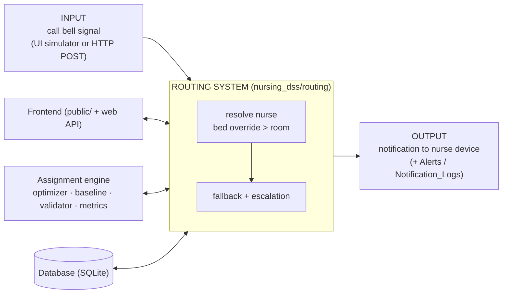

# Smart Nursing Assignment & Routing Decision Support System

Group 07 (Sec C01) · Heba Sajid · Jisu Hwang · Hasnan Asif

Decision support for charge nurses: recommend balanced, distance-aware patient assignments, let the charge nurse
review and edit them, then route every patient call bell to the nurse currently responsible.

> **Prototype with demo data only. Do not enter real patient information** (PHIPA). Charge nurses keep full
> authority to override; metrics are for shift balancing, never for performance appraisal.

## Architecture: INPUT → ROUTING SYSTEM → OUTPUT

The routing system is the hub. The frontend, the assignment engine and the database all connect to it.



| Part | Folder | Responsibility |
|---|---|---|
| **Input** | `nursing_dss/input/` | Validates a call bell signal (`parse_signal`); optional HTTP gateway for hardware |
| **Routing system** | `nursing_dss/routing/` | `RoutingSystem`: resolves the responsible nurse, falls back when nobody is assigned, reroutes on delivery failure, escalates un-acknowledged alerts, writes `Alerts` and `Notification_Logs` |
| **Output** | `nursing_dss/output/` | `Notifier` interface + `SimulatedNotifier` (swap in SMS/push later without touching anything else) |
| **Assignment engine** | `nursing_dss/assignment/` | Optimizer (greedy + local search), manual baseline, rule checker, walking routes (nearest-neighbour + 2-opt), metrics |
| **Database** | `nursing_dss/database/` | Schema + migration, the only module containing SQL, demo seed |
| **Frontend** | `public/` + `nursing_dss/web/` | Static web app (4 tabs) and a JSON API that only calls `RoutingSystem` |
| **Vercel entry** | `api/index.py`, `vercel.json` | Exposes the WSGI app as a serverless function |

## Run locally

Python 3.10+. No packages to install.

```bash
python serve.py                    # http://127.0.0.1:8000 (seeds a demo unit on first run)
python serve.py --gateway-port 8765   # also accept raw call-bell POSTs:
curl -X POST localhost:8765/bell -d '{"bell_id": 1011}'
python -m unittest discover -s tests -t . -v      # 45 tests
python scripts/benchmark.py --runs 100            # baseline vs optimizer
```

## Put it on GitHub, then Vercel

```bash
cd smart-nursing-dss
git init && git add . && git commit -m "Smart Nursing DSS"
git branch -M main
git remote add origin https://github.com/<you>/<repo>.git
git push -u origin main
```

Then on vercel.com: **Add New → Project → import the repo → Framework Preset: Other → Deploy**
(leave Build Command and Output Directory empty). Vercel serves `public/` as the site and runs `api/index.py` for `/api/*`.
GitHub Actions (`.github/workflows/ci.yml`) runs the tests on every push.

### Important: the database on Vercel is a demo database

Vercel functions have no persistent disk. On Vercel the app keeps SQLite in `/tmp`, which is **temporary and not
shared between serverless instances**: data can reset after idle time or a redeploy, and in rare cases two requests
may land on different instances. It re-seeds the demo unit automatically, so the site always works, but treat saved
assignments and alerts as demo state. For a persistent deployment, replace the storage in
`nursing_dss/database/repository.py` with a hosted database (for example Neon Postgres or Turso/libSQL). It is the
only file with SQL, so nothing else changes.

## Changes from the notebook / design document

All 8 tables are kept. Additions (update the design doc's database table to match):

* `Nurses`: `available`, `mobility_restricted` (needed for the availability and mobility rules)
* `Alerts`: `acknowledged_at`, `parent_alert_id` (escalation chain), `status` limited to
  `DISPATCHED, ACKNOWLEDGED, ESCALATED, ESCALATED_UNASSIGNED, DELIVERY_FAILED, ESCALATION_FAILED`
* `Notification_Logs`: `sent_at`, `latency_ms`, `detail` (response-time validation)
* Uniqueness: one *active* assignment per room and per bed; unique unit names, room numbers per unit, bed labels per room
* Cascading deletes so removing a room or bed cleans up its bells, assignments and alerts
* Rule: a **bed-level assignment overrides a room-level one**; assigning a whole room clears bed overrides inside it
* Demo seed: Alice Smith is now `CHARGE` (the system needs a charge nurse to fall back to when a bed has no assignee)
* An existing `nursing_system.db` from the Colab notebook is migrated automatically

## Assumptions to confirm with a clinical stakeholder (`nursing_dss/config.py`)

* Highest acuity per role: CHARGE 5, RN 5, RPN 4, STUDENT 2
* "Nearby" for a mobility-restricted nurse: rooms within 30 m of the station and within 20 m of each other
* Optimizer weights, 60 s acknowledgement timeout, at most 3 nurses per escalation chain
* Distances are straight-line between room coordinates; routes start at the station and do not return

## How the tests map to the Validation Strategy

`tests/test_validation_strategy.py`: routing accuracy (every bell → assigned nurse), reassignment handling (including
bed-over-room precedence), response time (routing and notification latency), workload fairness (30 random units:
optimizer vs manual baseline), edge cases (no assignee, no phone, device failure, unavailable nurse, unknown bell,
broken notifier), and escalation. `tests/test_api.py` exercises the same WSGI app Vercel runs.

## Limitations

* Notifications are simulated; a real SMS/push/pager integration is a new `Notifier` subclass.
* Escalation runs when `escalate_pending()` is called (the "Run escalation check" button). A real deployment needs a
  scheduler (for example a cron job calling an endpoint every few seconds on a long-running host).
* The floor map is accessible (text labels, key, table equivalent) but not drag-and-drop.
